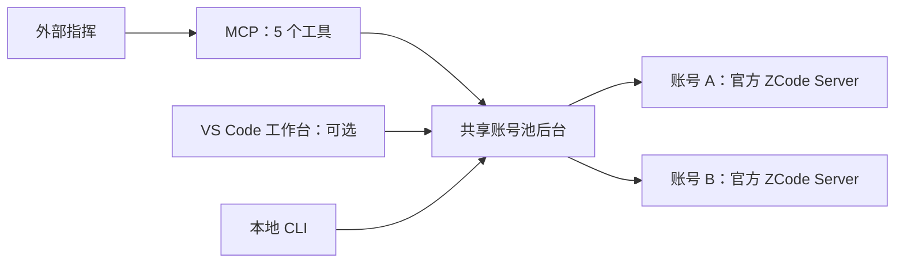

# ZCode Pool

为 Codex 等外部指挥 agent 提供共享账号池，用多个独立账号的官方 ZCode Server 执行代码任务。后台统一管理账号、工作目录、执行恢复与交付，VS Code 工作台提供可选的任务和额度监控。

当前版本为 `0.1.0`，适配官方 ZCode Server `3.16.3` / server protocol `1`，不修改官方安装包。实际验证范围见[当前验证与限制](docs/validation/current.md)。

## 功能

- **共享账号调度**：多个指挥共用一个池，按并发配额和公平队列分配账号；一个账号对应一个独立执行器，同一时刻由一个指挥控制，执行器内部不派生子 agent。
- **任务与验收闭环**：接收总目标或已拆分任务，管理阶段依赖、工作目录、固定交付、验收登记和成果整合。阶段完成由指挥确认，返工会撤销完成显示。
- **执行恢复与续接**：基于执行证据恢复可重试的通道故障，静默时只读核查；执行状态未知时保留账号占用。账号、任务与必要续接数据保存在本地。
- **可选工作台**：共享池与项目视角、阶段依赖图、集中待办、可折叠资源、全量账号额度探查和分类错误记录；额度显示官方来源、查询时间及失败或过旧状态。
- **按需运行**：后台独立于界面，由指挥明确开工并在完成后尝试安全收工，未使用时无需常驻。导入凭据保存在固定池的本地加密账号库中。

## 工作方式



外部指挥负责拆分任务、安排并行、验收和返工；后台负责账号互斥、目录准备、执行和事实记录。MCP 只需配置一个服务器，提供交办、等待、推进、按需查看与池控制五个工具。日常也可在 CLI、tmux 等终端环境使用，无需逐项操作工作台。

## 环境要求

| 组件 | 要求 |
| --- | --- |
| 执行侧 | Linux、Node.js 24+、Git |
| 官方运行环境 | ZCode Server 3.16.3 / server protocol 1，已完成官方初始化 |
| 账号 | 可导入的 OAuth JSON，以及对应账号的 Start Plan 额度 |
| 可选工作台 | VS Code 1.95+；Remote SSH 时将扩展安装到 Linux 远程执行侧 |
| 源码开发 | npm，用于安装依赖、检查与打包 |

指挥、MCP、后台与账号池应位于同一 Linux 执行侧。使用隔离 worktree 时，目标项目需要已有 Git 基线。其他环境、版本和未验证能力见[验证边界](docs/validation/current.md#有效边界)。

## 快速开始

### 一次设置

普通使用安装一体 VSIX，已包含本项目工作台、后台、CLI 和 MCP；Node.js、官方 ZCode 与账号需单独准备。VSIX 可按下方[源码开发与打包](#源码开发与打包)生成。

1. 在 VS Code 执行 **Extensions: Install from VSIX...**，选择 `zcode-pool-0.1.0.vsix`。Remote SSH 时安装到 Linux 远程扩展主机。
2. 打开 **ZCode Pool: Open Workbench**，确认执行侧与连接目录。默认使用执行侧用户的固定池 `~/.zcode_pool`，与当前项目目录无关；可用“选择连接目录”指定其他池。
3. 点击“启动后台并连接”，在“额度与资源”导入账号 OAuth JSON。此操作不发起模型任务。
4. 点击“连接 Codex / 生成 MCP 配置”，按说明将一个 MCP 服务器一次添加到同一执行侧的 Codex，再重新连接。生成说明不会改写 Codex 设置；用池读取工具确认连接到同一目录。

配置完成后，日常无需手动启动每个执行器或建立 worktree。无需工作台的独立 CLI/MCP 安装见[安装与交付](docs/distribution.md)。

### 每次开工与收工

在指挥入口说明项目、目标、验收要求及本次申请的账号数，也可以直接提供拆分后的任务。例如：

> 在当前项目完成……，这次使用 2 个账号，以……作为验收条件。

指挥先明确调用 `zcode_pool_control` 的 `start`，再交办、等待和组织验收。未提供验收条件时，由指挥补充少量可观察的完成标准。实际资源少于申请数时，须先确认可用数量再部分推进。

- **本轮完成**：成果整合并通过最终验收、总任务标记完成后，指挥自动尝试 `shutdown`，传 `only_if_idle: true`。全池任何未完成工作，包括其他指挥及待资源、验收、待决定的工作，都会阻止收工；拒绝后保持后台运行，不改用手动语义绕过。
- **用户明确停工**：保存当前安排与续接状态后，可使用手动收工，保留无执行占用的未完成工作。实际或未知执行占用仍会拒绝收工，不强制停止任务。

关闭 VS Code、断开面板或指挥异常离线不会判定完工。只读查询不会启动已关闭的后台；再次使用需明确开工。升级扩展也不会自动重启旧后台。完整约定见[指挥使用约定](docs/codex-workflow.md)和[后台启动与收工](docs/service.md#普通使用的启动与收工)。

## 源码开发与打包

在仓库根目录安装依赖并执行基础检查：

```bash
npm ci
npm --prefix extensions/vscode ci
npm run typecheck
npm test
npm --prefix extensions/vscode run build
npm --prefix extensions/vscode run test:unit
```

构建并检查一体 VSIX：

```bash
npm --prefix extensions/vscode run package:vsix
npm --prefix extensions/vscode run package:check
```

输出为 `extensions/vscode/zcode-pool-0.1.0.vsix`。核心源码位于 [`src/`](src/)，扩展位于 [`extensions/vscode/`](extensions/vscode/)，脱敏测试位于 [`test/`](test/)。默认测试使用 fixture、临时目录和模拟运行时，不发送模型请求；UI、宿主、安装包及显式真实模型检查见[工作台开发指南](docs/ui/implementation.md#检查与打包)。独立 daemon 包和可选 systemd 用户服务见[安装与交付](docs/distribution.md)。

## 文档

| 主题 | 文档 |
| --- | --- |
| 安装、工作台操作与 F5 开发 | [工作台使用与开发](docs/ui/implementation.md) |
| 指挥交办、等待、验收与收工 | [指挥使用约定](docs/codex-workflow.md) |
| 产品要求与功能约束 | [需求说明](docs/requirements.md) |
| 架构、调度与官方运行时 | [设计入口](docs/design/README.md) |
| 源码运行与高级 CLI | [开发指南](docs/development.md) |
| 打包、独立安装与 systemd | [安装与交付](docs/distribution.md) · [后台服务](docs/service.md) |
| 执行恢复与故障处理 | [恢复规则](docs/recovery.md) · [重试与静默](docs/busy-recovery.md) |
| 本地数据与上下文预算 | [存储布局](docs/storage-layout.md) · [上下文策略](docs/context-policy.md) |
| 已验证范围与当前问题 | [当前验证与限制](docs/validation/current.md) · [未决事项](docs/open-items.md) |

## 参与贡献

反馈问题时请提供复现步骤、执行环境和脱敏日志。提交改动前运行相关类型检查与测试，并同步更新对应文档。账号导出、凭据、池数据及运行产物不应提交到 Git。

## 许可证

项目源码目前未授予开源许可，扩展清单标记为 `UNLICENSED`。项目及捆绑第三方软件的许可说明见 [`extensions/vscode/LICENSE`](extensions/vscode/LICENSE)。
