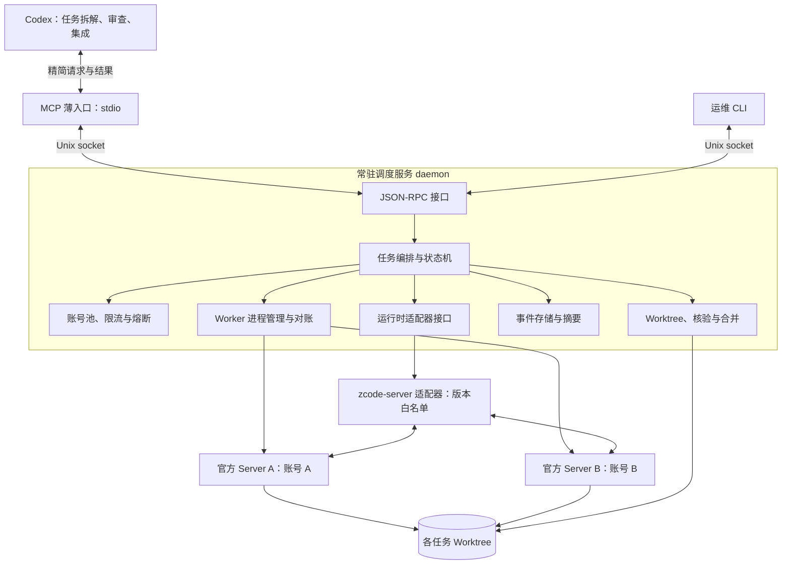

# 方案总览

[项目入口](../../README.md) · [方案总览](README.md)

更新日期：2026-11-01（北京时间）。本文为设计与调研记录，不代表功能已经实现。

当前状态：首版已实现，并完成本机单实例真实任务、会话续接与双账号并行验证。本文保留目标架构，实际交付范围及未完成项见[首版实测记录](../validation/2026-11-01.md)。

## 目标与选型结论

构建一个本地常驻调度服务，由 Codex 通过 MCP 控制多个绑定不同账号的 ZCode Worker，持续推进项目开发。

核心要求：

- **纯后台、无桌面弹窗**：主线直接运行官方 ZCode Server，不启动 Electron，不依赖 Xvfb。
- **多账号隔离**：每个 Worker 固定账号、数据目录和服务实例；代码工作区单独管理。
- **会话连续**：后续任务能够续接指定 Worker 的原会话；账号不可用时可把工作区交接给其他 Worker。
- **上下文受控**：完整会话、工具事件和日志保留在本地；Codex 默认只接收状态、简短总结、修改摘要、测试结果和阻塞问题。
- **保留官方执行路径**：使用官方 Server 与 Agent 运行时，通过启动配置和本地协议接入，不修改安装包。
- **以活动额度为目标**：必须验证实际使用 Start Plan 及对应账号的活动额度，不能把服务启动成功等同于额度验证成功。

**首选方案：官方 Server 多实例 + 常驻调度服务（系统核心）+ MCP 薄入口 + 版本化运行时适配器。** 账号注入与目录隔离参考 Cockpit 的实现。

各接入形态的职责划分：

- **常驻调度服务**持有全部状态和 Worker 生命周期，是系统核心。
- **MCP** 只是 Codex 的工具入口，进程可以随时退出重连。
- **Codex 技能或插件**只用于后续打包分发。
- **不修改 ZCode**，对官方私有协议的依赖全部收敛在运行时适配器内，并做版本白名单检查。

决策依据见[系统架构](architecture.md#接入形态决策)。

## 总体架构

关键设计点：

1. **daemon 与客户端分离**：MCP、CLI 都是无状态客户端；Codex 断开不影响 Worker，daemon 重启后通过对账接管仍在运行的 Server 实例。
2. **Worker 与 Workspace 解耦**：Worker 是"账号 + Server 实例"，Workspace 是"仓库 + worktree + 分支"。会话不跨账号迁移，但工作区可以带着交接摘要交给其他 Worker。
3. **适配器隔离私有协议**：上层只依赖归一化接口和事件；协议升级只影响适配器；另有 Fake 适配器用于不耗额度的测试。
4. **异步派发 + 有界等待**：派发立即返回任务标识，Codex 通过有超时上限的等待工具获取进展，避免撞上 MCP 工具调用超时，也避免频繁轮询消耗上下文。
5. **故障分类处理**：限流和服务端错误走退避与同会话续跑；风控和鉴权失效立即停用账号，不自动重试。
6. **以 Git 和核验命令为准**：ZCode 的完成总结只作参考，由 daemon 收集完整变更并运行项目配置的测试命令。

## 专题导航

| 文档 | 内容 |
| --- | --- |
| [系统架构与模块划分](architecture.md) | 接入形态决策、进程拓扑、核心概念、模块边界、适配器接口 |
| [调研依据与方案比较](research-and-options.md) | 已核实事实、历史记录、候选运行路径和源码依据 |
| [账号隔离与实例运行](worker-runtime.md) | 账号池、目录规范、凭据、进程管理与协议接入 |
| [任务调度与代码集成](task-orchestration.md) | 数据模型、状态机、故障处理、Git 工作流和 MCP 接口 |
| [实施路线与验收标准](validation-roadmap.md) | 从单实例验证到开发闭环的验收门槛 |
