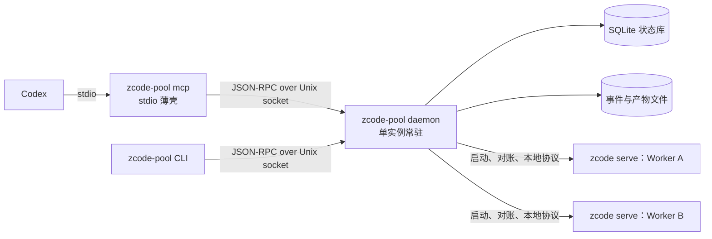

# 系统架构与模块划分

[项目入口](../../README.md) · [方案总览](README.md)

更新日期：2026-11-01（北京时间）。本文为设计与调研记录，不代表功能已经实现。

## 接入形态决策

"MCP、插件还是侵入式"不是单选题。各形态在系统中承担不同职责：

| 形态 | 在本系统中的角色 | 结论 |
| --- | --- | --- |
| 常驻调度服务（daemon） | 持有全部状态、Worker 生命周期、Git 操作与结果核验 | 采用，系统核心 |
| MCP（stdio） | Codex 调用调度服务的唯一工具入口，只做参数校验与转发 | 采用，薄适配层 |
| 本地 CLI | 人工运维、调试与阶段 1 原型验证 | 采用，与 MCP 共用同一服务接口 |
| 官方 Server 本地协议 | 驱动 ZCode 执行任务 | 采用，封装在版本化运行时适配器内 |
| Codex 技能或插件 | 分发 MCP 配置与 Codex 侧工作流说明 | 核心稳定后再打包，不承担架构职责 |
| 修改 ZCode 安装包、注入补丁、hook 桌面程序 | 无 | 不采用 |
| Codex 直接通过 shell 调用 ZCode CLI | 无 | 不作为主线 |

不采用侵入式修改的原因：

- 每次 ZCode 升级都可能失效，维护成本随版本持续累积。
- 改动后的客户端行为偏离官方，更可能触发风控，前期已有 `3012 unusual activity` 记录。
- 故障出现时无法区分是自身补丁还是官方服务问题。

不让 Codex 直接调用 ZCode CLI 的原因：本机裸 Agent 的独立鉴权路径要求 `individual-coding-plan`，不能使用 Start Plan 活动额度；同时，采用 daemon 统一管理会话、持久状态与返回内容；shell 本身并不排斥这些能力。

不把核心逻辑放进 MCP 进程的原因：MCP 进程由 Codex 拉起，随 Codex 会话结束而退出。Worker、任务状态和 Git 工作区若归 MCP 进程持有，Codex 重启或断开就会丢失状态或误停任务。

## 进程拓扑



规则：

- **daemon 单实例**：通过 `~/.zcode_pool/scheduler/daemon.lock` 保证同一时刻只有一个 daemon。
- **客户端无状态**：MCP 与 CLI 不保存任务状态，退出不影响 daemon 与 Worker。MCP 的每个工具一对一映射到 daemon 的 JSON-RPC 方法。
- **本地接口**：daemon 监听 `~/.zcode_pool/scheduler/daemon.sock`，权限 `0600`，不监听 TCP 端口。
- **daemon 启动方式**：MCP 或 CLI 连接失败时，以脱离终端的方式拉起 daemon 并等待就绪；也可以选用 systemd 用户服务常驻。两种方式不能同时管理同一个 daemon。
- **Worker 进程与 daemon 解耦**：`zcode serve` 以独立进程组启动，并在状态库中登记 PID、启动时间和 server root。daemon 重启后先对账（读取 `run/status.json` 并实时请求 `server-info`），再决定接管还是重启，不能因为 daemon 退出就终止正在执行的任务。官方 Server 在父进程退出后的实际行为需要在阶段 2 验证。

## 核心概念

| 概念 | 含义 | 约束 |
| --- | --- | --- |
| Account | 一个 ZCode 账号及其凭据与健康状态 | 凭据只在账号模块和 Worker 管理模块内以明文出现 |
| Worker | 绑定一个账号的官方 Server 实例，拥有独立 server root | 第一版每个 Worker 同时只运行一个任务 |
| Workspace | 一个代码工作区：仓库、worktree、分支和起始 commit | 与 Worker 解耦，可以先后交给不同 Worker 处理 |
| Session | Worker 内的 ZCode 会话，绑定一个 Workspace | 属于所在 Worker 的账号，不能跨 Worker 迁移 |
| Task | 一次派发，记录使用的 Worker、Workspace 和 Session | 携带幂等请求标识 |

Workspace 与 Worker 解耦后，一个账号额度用尽或被风控时，可以把同一工作区交给另一个 Worker 继续推进。交接方式是在新 Worker 中新建会话，并附带由前序任务结果生成的交接摘要，而不是迁移原会话。交接只在原任务处于终止状态后进行。

## daemon 模块划分

| 模块 | 职责 | 允许依赖 |
| --- | --- | --- |
| `api` | JSON-RPC 服务、参数校验、返回大小限制、幂等键检查 | `orchestrator`、`store` |
| `orchestrator` | 任务队列与状态机、Worker 选择、重试和交接策略 | `accounts`、`supervisor`、`workspace`、`events`、运行时适配器接口 |
| `accounts` | 导入与去重、加密存储、健康状态、按账号限流与熔断 | `store` |
| `supervisor` | Worker 目录准备、凭据注入、启动、停止、对账与健康检查 | `accounts`、`store` |
| `runtime` | 运行时适配器接口与实现，如 `zcode-server` | 无上层依赖 |
| `workspace` | worktree 管理、完整变更收集、运行核验命令、合并 | `store` |
| `events` | 归一化事件落盘、游标、脱敏、摘要提取 | `store` |
| `store` | SQLite（WAL 模式）访问与迁移 | 无 |

依赖规则：

- 只有 `runtime` 了解 ZCode 本地协议细节；上层只依赖归一化接口与事件类型。
- 账号凭据由 `accounts` 和 `supervisor` 管理；`runtime` 可读取建立连接所必需的服务入口令牌。`api`、日志与事件不返回上述秘密。
- `orchestrator` 不直接执行 Git 命令或启动进程，分别经由 `workspace` 和 `supervisor` 完成。

## 运行时适配器接口

适配器把官方 Server 的私有协议转换为稳定接口。以下为接口草案，具体字段以阶段 1 抓取的协议为准：

```ts
interface RuntimeAdapter {
  readonly id: string; // 如 "zcode-server/3.16.x/proto-1"
  supports(info: RuntimeInfo): boolean;
  probe(endpoint: WorkerEndpoint): Promise<RuntimeInfo>;
  connect(endpoint: WorkerEndpoint): Promise<RuntimeConnection>;
}

interface RuntimeConnection {
  openSession(input: { workspacePath: string; sessionId?: string }): Promise<SessionRef>;
  // 只表示服务已接收，不代表回合完成
  sendTurn(session: SessionRef, input: TurnInput): Promise<TurnRef>;
  events(session: SessionRef, cursor?: string): AsyncIterable<RuntimeEvent>;
  respondApproval(turn: TurnRef, approvalId: string, decision: ApprovalDecision): Promise<void>;
  cancel(turn: TurnRef): Promise<void>;
  syncHistory(session: SessionRef): Promise<SessionSnapshot>;
  close(): Promise<void>;
}
```

归一化事件类型：`turn_started`、`assistant_message`、`tool_call`、`tool_result`、`approval_requested`、`usage`、`error`、`turn_completed`、`turn_failed`。其中 `error` 必须携带分类：`rate_limited`、`server_error`、`risk_blocked`、`auth_invalid`、`unknown`，调度策略依据分类决定后续动作，见[任务调度](task-orchestration.md#故障分类与处理)。

兼容性规则：

- 适配器按版本范围白名单声明支持范围。`probe` 结果不在范围内时拒绝连接，不尝试"兼容运行"。
- ZCode 升级后，先用真实实例运行协议契约测试，通过后再扩大白名单。
- 官方 Web 发行版、Electron + Xvfb 等备选路径以新适配器实现，上层不变。

另实现一个用于测试的 Fake 适配器，按阶段 1 录制并脱敏的事件序列回放，使状态机、重试与恢复逻辑可以在不消耗额度的情况下测试。

## 程序结构（规划）

实现时在项目根目录创建单一 TypeScript 包，通过子命令区分进程角色：

```text
zcode-pool/
├── src/
│   ├── daemon/          # api、orchestrator、accounts、supervisor、workspace、events、store
│   ├── runtime/
│   │   ├── types.ts     # 适配器接口与归一化事件
│   │   ├── zcode-server/
│   │   └── fake/
│   ├── mcp/             # stdio MCP 服务，转发到 daemon.sock
│   ├── cli/             # 运维与调试命令
│   └── shared/          # JSON-RPC 方法定义与参数 schema
└── test/
    └── fixtures/        # 脱敏后的协议录制样本
```

`shared` 中的方法定义同时生成 MCP 工具 schema 与 CLI 参数，保证两个入口的行为一致。选择 Node.js/TypeScript 的原因是官方 Server 为 JS 实现，便于对照源码适配协议，且 MCP TypeScript SDK 成熟。
