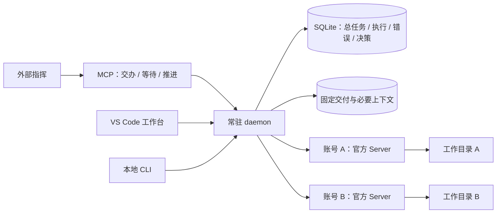

# 系统架构

[设计入口](README.md) · [需求说明](../requirements.md) · [验证范围](../validation/current.md)

采用常驻 daemon、精简 MCP 入口、独立官方 Server 和 VS Code 工作台。daemon 拥有执行与资源事实，外部指挥拥有安排、验收和阶段确认。客户端退出不影响已经派发的工作；新的语义安排等待指挥恢复。

## 模块与责任

| 位置 | 责任 |
| --- | --- |
| `src/core/store.ts`、`work-store.ts` | 持久状态、幂等、执行占用、总任务、指挥归属、设置和实际错误记录 |
| `src/daemon/work.ts` | 高层交办与推进、公平分配、工作目录、固定交付、验收登记和整合 |
| `src/daemon/coordinator*.ts`、`execution-recovery.ts` | 原生执行、审批、停止证明、持续恢复与静默核查 |
| `src/daemon/workspace.ts`、`artifacts.ts` | Git/worktree、保存成果、本地核验、不可变文件工件 |
| `src/accounts/`、`src/supervisor/` | 凭据库、账号隔离、官方进程生命周期与身份核对 |
| `src/runtime/` | 官方版本限制、协议、受控会话、只读原会话快照与事件归一化 |
| `src/shared/` | 参数、领域与 UI 合同、MCP 白名单投影及预算 |
| `src/mcp/`、`src/cli/` | 工具与人工入口，均不拥有执行状态 |
| `extensions/vscode/` | 展示与明确用户动作，业务事实由后台提供 |

daemon 通过当前池的 Unix socket 提供 JSON-RPC，持有单实例锁。SQLite 使用 WAL。MCP 只公开交办、等待、推进、按需查看和池控制五个日常工具；高级逐次执行操作保留在本地 CLI 与 UI。

进程 ready、请求收到、实际执行、原生终止、本地核验完成和指挥验收是不同事实。账号只在已证实停止、成果及必要上下文保存后释放。工作区与账号解耦，跨账号交接使用保存成果与精简上下文，不迁移原生会话。

官方私有协议只位于运行时适配器。Host 不导入 daemon、SQLite 或运行时；Webview 不持有凭据、socket 或文件系统能力。面板与 MCP 各自按需读取，面板正文不会自动进入指挥上下文。

具体任务与状态见[任务调度](task-orchestration.md)，账号与协议边界见[官方运行时](worker-runtime.md)，UI 合同见[工作台设计](../ui/design.md)。
