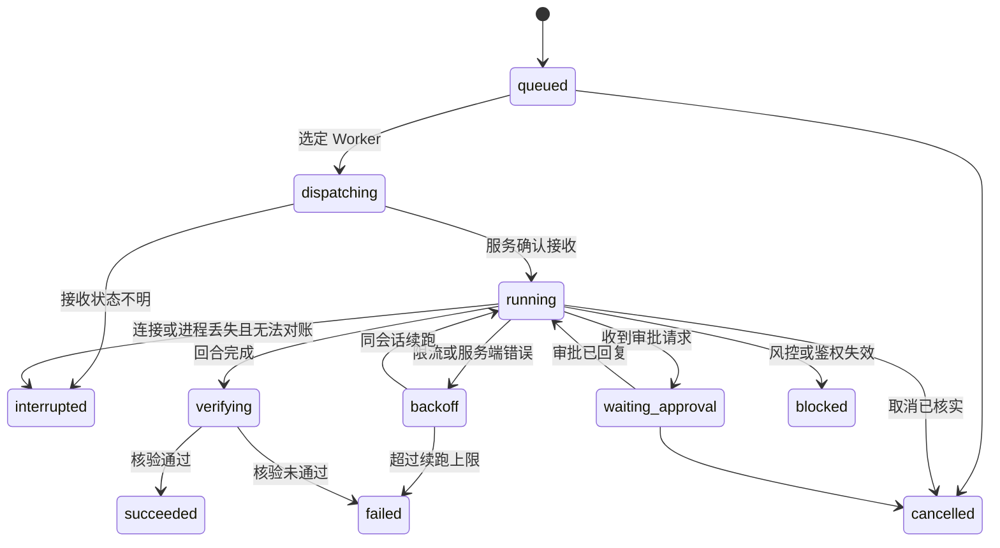

# 任务调度、上下文与代码集成

[项目入口](../../README.md) · [方案总览](README.md)

更新日期：2026-11-01（北京时间）。本文为设计与调研记录，不代表功能已经实现。

概念定义与模块边界见[系统架构](architecture.md#核心概念)。

## 数据模型

状态库使用 SQLite（WAL 模式），位于 `~/.zcode_pool/scheduler/state.db`。主要表：

| 表 | 关键字段 |
| --- | --- |
| `accounts` | `account_id`、别名、provider、稳定用户标识、健康状态、冷却截止时间、最近错误分类 |
| `workers` | `worker_id`、`account_id`、server root、运行时版本、适配器标识、PID 与启动时间、状态 |
| `workspaces` | `workspace_id`、仓库路径、worktree 路径、分支、起始 commit、状态（活跃、已合并、已放弃） |
| `sessions` | `session_id`、`worker_id`、`workspace_id`、ZCode 原生会话标识 |
| `tasks` | `task_id`、`request_id`（唯一）、所用 Worker/Workspace/Session、状态、续跑次数、事件游标、结果引用 |
| `approvals` | `approval_id`、`task_id`、请求内容摘要、决定、决定来源 |

完整事件按任务写入 `~/.zcode_pool/scheduler/events/<task_id>.jsonl`；diff、核验输出和交接摘要写入对应 Worker 的 `artifacts/`。状态库只保存索引与摘要。

## 任务状态机

- `dispatching` 与 `running` 分开：命令发出但未确认接收时，断线后先调用 `syncHistory` 对账，不直接重发。
- `verifying` 由 daemon 执行：收集完整变更并运行核验命令；ZCode 自述完成不等于成功。
- `failed` 表示开发任务未达成，不代表 Worker 不可用。
- `blocked` 和 `interrupted` 都需要 Codex 或人工决定后续处理，daemon 不自动重放。

## 调度与 Worker 选择

- 第一版每个 Worker 同时只有一个非终止任务，每个账号只绑定一个 Worker。这是调度策略，不是对云端并发上限的声明。
- 派发时可以指定 `worker_id`；未指定时，优先选择已持有该 Workspace 会话的空闲 Worker，其次选择健康且空闲的 Worker。
- 冷却或停用中的账号不参与调度。
- 同一 Workspace 同时只允许一个活动任务，避免两个 Worker 修改同一工作树。
- 每次派发携带 `request_id`；重复的 `request_id` 返回原任务，不重复创建。

## 故障分类与处理

ZCode 免费额度常见"繁忙"、限流、502 以及风控拦截。适配器负责把它们归入统一分类，编排层按分类处理：

| 分类 | 典型表现 | 处理方式 |
| --- | --- | --- |
| `rate_limited` | HTTP 429、并发限制、"繁忙"提示 | 先对账确认原回合终止；确认可继续后进入有上限的退避，不能仅凭错误码重发；该账号短暂冷却 |
| `server_error` | 502、连接重置、上游超时 | 执行状态可能未知：恢复订阅或保持 interrupted；明确终止后才允许决定续跑，连续故障时短暂熔断 |
| `risk_blocked` | `3012 unusual activity` 等风控响应 | 任务进入 `blocked`，账号标为停用，**不自动重试**，等待人工处理 |
| `auth_invalid` | 凭据过期或身份无效 | 任务进入 `blocked`，账号标为失效，需要重新导入凭据 |
| `unknown` | 未识别的错误 | 任务进入 `interrupted`，保留现场并上报 |

规则：

- 续跑在同一会话内进行，不重新发送原始提示词，避免重复执行已完成的步骤。每个任务的续跑次数和总退避时长都有上限，初始值在配置中给出，由实测调整。
- 退避与限流按账号计算，不在多个账号之间轮换重试同一回合：会话属于账号，换账号意味着交接，而不是重试。
- 执行状态不明时先对账；已有文件修改时，不会因为重试而丢弃。
- 不对风控做规避处理。账号被风控时保留现场，由人工判断是否继续使用该账号。

## 审批与执行策略

- 执行策略由项目配置决定，接口不默认写死 `mode="yolo"`。
- 配置可以声明自动批准的操作类别，例如工作区内的文件编辑、白名单内的测试命令；其余审批请求让任务进入 `waiting_approval`，由 Codex 通过工具回复。
- 每个审批决定都记录来源（自动规则或 Codex），便于审计。
- 等待审批的超时时间可配置；超时后按配置取消或保持等待，不得默认批准。

## 交接

账号进入冷却、停用或额度不足，而工作区还需继续推进时：

1. 确认原任务终止，且旧 Agent 和相关执行进程不再写入工作区；仅修改数据库状态不够。无法确认时保留工作区占用，不交接。
2. daemon 根据原任务的结果、变更清单和核验输出生成交接摘要，写入 `artifacts/`。
3. 在目标 Worker 中为同一 Workspace 新建会话，以交接摘要作为首个任务的上下文。
4. 原会话保留，不删除、不迁移。

交接需要 Codex 显式发起（派发时传入 `session: "new"` 和新的 `worker_id`），daemon 不自动切换账号。

## 上下文控制

以下为初期设计；当前已实现的输出预算、字段与分页规则以 [上下文输出策略](../context-policy.md) 为准，主会话流程见 [调度约定](../codex-workflow.md)。

- `zcode_wait` 返回状态变化和精简进度；`zcode_get_result` 返回摘要、修改文件列表、核验结果、阻塞问题和产物引用。
- 完整会话不自动回传。日志与 diff 按需分页读取，单次返回有大小上限，初始值暂定摘要 2 KB、单次结果 8 KB，由实测调整。
- 摘要优先取 ZCode 最终回复，超长时截断并标明截断；daemon 不调用额外模型做二次总结，避免消耗额度。
- Token 使用量与套餐剩余额度分别记录。未知值返回未知，不能根据任务完成或本地计数推算云端余额。

## Git 工作流与结果核验

- 创建 Workspace 前检查目标仓库、可用基线和未提交变更，不假定分支一定叫 `main`。
- 每个 Workspace 对应独立分支和 worktree，记录起始 commit。默认放在 `~/.zcode_pool/workspaces/<workspace_id>/`，可在配置中修改。
- `cwd` 和 worktree 是工作组织方式，**不是文件系统安全边界**。若需限制文件访问，应另加容器、系统用户或沙箱。
- 收集变更时覆盖未暂存、已暂存、未跟踪文件，以及 Worker 自己创建的提交；单独执行 `git diff` 不足以代表全部交付。
- 核验命令（构建、测试、lint）在项目配置中声明，由 daemon 在 `verifying` 阶段运行，记录退出码与输出摘要。ZCode 的完成总结与实际差异、核验结果分别保存，由 Codex 审查。
- 集成到明确目标分支前检查冲突并重新运行核验；不覆盖用户未提交内容。
- 合并与清理拆开：确认集成结果后再清理 worktree。失败、冲突或未审查的结果必须保留。

## 拟提供的 MCP 工具

以下是拟定接口，不代表已经实现。每个工具对应 daemon 的一个 JSON-RPC 方法，CLI 提供同名子命令。

| 工具 | 主要参数 | 行为 |
| --- | --- | --- |
| `zcode_overview` | 无 | 一次返回账号别名与健康状态、Worker 状态、活动任务 |
| `zcode_start_worker` | `worker_id`, `account_id` | 准备目录、注入凭据、启动或接管实例并检查就绪 |
| `zcode_stop_worker` | `worker_id` | 停止实例；有活动任务时拒绝执行，要求先取消 |
| `zcode_create_workspace` | `repository`, `base_ref`, `branch?` | 创建 worktree 与分支，返回 `workspace_id` |
| `zcode_dispatch_task` | `workspace_id`, `prompt`, `request_id`, `worker_id?`, `session?`, `execution_policy?` | 异步派发，立即返回 `task_id`；`session` 取 `continue` 或 `new` |
| `zcode_wait` | `task_ids`, `after_revision?`, `timeout_sec?` | 返回指定 revision 之后的变化及新 revision；已终止任务立即返回，`timeout_sec=0` 为立即查询 |
| `zcode_get_result` | `task_id` | 返回摘要、修改清单、核验结果、阻塞问题与产物引用 |
| `zcode_get_diff` | `task_id`, `path?`, `cursor?`, `limit?` | 分页返回完整交付范围内的差异 |
| `zcode_get_logs` | `task_id`, `cursor?`, `limit?` | 分页返回脱敏后的事件片段 |
| `zcode_respond_approval` | `task_id`, `approval_id`, `decision` | 回复审批请求 |
| `zcode_cancel_task` | `task_id` | 发起取消并核实最终状态 |
| `zcode_merge_workspace` | `workspace_id`, `target_ref`, `expected_base` | 按项目规则合并已审查结果，返回冲突或核验结果 |
| `zcode_cleanup_workspace` | `workspace_id` | 仅在已合并或明确放弃后删除 worktree |

`zcode_wait` 的超时上限必须小于 Codex 的 MCP 工具调用超时（Codex 配置项 `tool_timeout_sec`，以实际配置为准），默认值暂定 30 秒。这样 Codex 可以同时等待多个 Worker，单次调用不会超时，也不必频繁轮询。

审批请求的具体字段在协议原型完成后补充，避免在协议验证前固化参数。

## Codex 侧工作流

在 Codex 的技能说明或项目 `AGENTS.md` 中约定以下流程，后续可随插件一起分发：

1. 用 `zcode_overview` 查看可用 Worker。
2. 把需求拆成文件范围尽量不重叠的子任务，每个子任务对应一个 Workspace。
3. 并行派发，用 `zcode_wait` 等待多个任务。
4. 读取结果，只在需要时分页获取 diff 和日志。
5. 审查不通过时，在同一会话派发修正任务；任务进入 `blocked` 时决定是否交接。
6. 审查通过后合并，并在目标分支上确认核验结果，最后清理工作区。

## 实现补充：崩溃与结果一致性

- request_id 同参数重复请求返回原任务；不同参数复用必须报错。派发前持久化意图，发出后未确认的任务不得自动重发。
- 工作区和 Worker 占用持久化；blocked/interrupted 不自动释放，必须记录执行已停止的证据。
- 归一化事件和任务 revision 在同一 SQLite 事务提交，JSONL 如有导出仅作为派生产物。
- 每个任务保存不可变结果与差异快照；旧任务查询不重新读取已被后续任务修改的工作树。
- 默认不自动续跑上游超时或连接重置的回合；状态未知优先保留现场。
