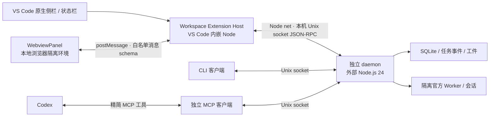

# VS Code 集成契约

状态：设计提案；当前没有 VS Code 扩展或下述新增 UI 接口。核对日期、源码基线、视觉和实施阶段见 [交互设计](interaction-design.md)。本文集中记录运行环境、状态字段、安全边界和接口缺口，不启动模型或更改 Codex 配置及服务。

## 传输、生命周期和运行环境

这是拟采用的集成关系；当前已有 daemon、CLI 与 MCP，图中的 VS Code 扩展和消息桥尚未实现。

扩展 Host 复用或提取轻量的 RPC 协议与纯数据 schema，以 `node:net` 连接 `scheduler/daemon.sock`。Webview 使用 `acquireVsCodeApi().postMessage()`，Host 经 `onDidReceiveMessage` 校验后调用白名单方法，再发送投影后的数据。Webview 不直接连接 socket、读取 vault、访问 Worker ingress endpoint 或执行 shell。VS Code 提供的是隔离 Webview 与消息通信机制，具体方法白名单和数据投影由本项目实现。[Webview API](https://code.visualstudio.com/api/extension-guides/webview)

扩展 manifest 推荐 `"extensionKind": ["workspace"]`，在 Remote SSH / WSL 中让 Host 与仓库、pool、daemon 位于同一侧。Webview 即使由远程扩展创建，仍在用户本地 UI/浏览器侧显示，因此不能用页面里的 `localhost` 代表远端，也不能把远端 Unix socket 路径当作可 fetch URL。资源使用 `asWebviewUri`，运行位置参考 [Extension Host](https://code.visualstudio.com/api/advanced-topics/extension-host) 与 [Remote Extensions](https://code.visualstudio.com/api/advanced-topics/remote-extensions)。

| 环境 | 第一阶段支持边界 |
| --- | --- |
| Linux 本机 VS Code | Node extension host 连接本机 daemon；仍需 Node 24 与已安装的受支持官方 runtime |
| Windows/macOS 的 VS Code + Remote SSH 到 Linux | 扩展安装在远端，连接远端同用户 pool；无需暴露管理 HTTP 端口 |
| Windows VS Code + WSL Linux workspace | 扩展、daemon、Worker、Node 24 都在同一 WSL 发行版；不连接 Windows 侧伪同名 pool |
| Windows/macOS 纯本机 workspace | 当前不支持本机 daemon；展示限制和远程运行指引，不宣称有跨平台进程所有权验证 |
| vscode.dev / github.dev，无远程 Node Host | 当前 Unix socket 方案不可运行；不是 browser-only 扩展 |
| Codespaces / Dev Container | 架构上可用远端 Node Host，但需单独验证 Linux `/proc`、runtime、存储和进程寿命；不作为首轮已支持环境 |

当前 daemon 的所有权检查依赖 Linux `/proc` 和 abstract Unix socket，supervisor 同样要求 Linux；受支持官方版本目前固定为 `3.16.3`。采用 VS Code 扩展不会自动消除这些限制。来源：[`daemon/server.ts`](../../src/daemon/server.ts)、[`supervisor/index.ts`](../../src/supervisor/index.ts)。

**不要直接把 coordinator、store 或 `node:sqlite` 打包进 extension host。** 仓库要求 Node.js 24，store 使用 `DatabaseSync`；VS Code 自带的 Host Node 版本由所用 VS Code 版本决定，不能按用户终端的 `node --version` 推断，也不能假定满足本项目要求。Host 只运行轻量 socket 客户端，daemon 仍用独立、明确的 Node 24 路径启动；不使用 extension host 的 `process.execPath` 代替 daemon runtime。本地和远程运行时也有原生模块兼容差异，官方对此有专门说明。[Remote Extensions：Node 模块](https://code.visualstudio.com/api/advanced-topics/remote-extensions#using-native-nodejs-modules)

打开视图只尝试连接已有 daemon。连接失败时显示“未连接”及诊断，不自动装依赖或运行项目脚本。后续可以提供显式“启动 daemon”命令，但必须使用用户级配置的绝对 Node 24、loader/构建入口和 pool 路径，先检查运行环境；不用工作区里的任意 `npm` 脚本。若用户已选择 systemd 管理，该命令应显示服务运行指引，不启动第二套管理者。

窗口 dispose/deactivate 只释放本窗口的 wait、socket 和界面订阅，不调用 `daemon_stop`、`stop_worker` 或 `cancel_task`。正常 daemon 关闭仍要等待已开始的核验完成；Worker 不随 daemon 主动停止，但这不保证跨注销、远端断电或系统重启存活。服务生命周期沿用 [现有 service 约定](../service.md)，不自动修改 systemd、linger、默认官方实例或 Codex MCP 配置。

## 对象与状态模型

### pool、项目、workspace、Worker 和账号

| 对象 | 身份与范围 | 界面表达 |
| --- | --- | --- |
| pool | 同一 Linux 主机、同一用户、同一个规范化 pool 路径；默认 `~/.zcode_pool`，可设 `ZCODE_POOL_HOME` | 页面常驻标识；不同主机上相同路径不代表同一个池 |
| 项目 | 当前用 workspace 的 `repositoryPath` 归组；尚无独立 project API | 展示仓库名及必要的父路径以消除同名歧义 |
| workspace | 一个已登记的隔离 git worktree，包含 `workspaceId`、源仓库、分支、`baseCommit`、`activeTaskId` | 与 VS Code 的“工作区窗口”分别命名；一个项目可有多个任务 workspace |
| 账号 | pool 范围的匿名 alias、provider、health；额度可能来自导入时快照 | 默认只展示 alias，不展示邮箱、token 或导入文件路径 |
| Worker | 绑定一个账号的官方 Server 实例；一个账号不能同时绑定另一个未停止的 Worker | 区分 `ready` 与空闲，区分原生活动数与调度占用 |
| 任务 | `taskId` 是任务身份；`request_id` 是派发幂等键；同一任务可有多次有界繁忙续跑 | 不把每次“继续”另建成列表任务；尝试记录属于该任务 |

同一 pool 的 CLI、Codex MCP、多个 VS Code 窗口共享 daemon 状态和占用。某窗口选择了账号或项目，只改变本地筛选，不抢占资源。前端预先检查仅帮助解释；真正的互斥和拒绝由 daemon/store 决定。不能把同一 pool 放在跨主机共享文件系统上当作分布式池。

本地连接标识建议使用“远程 authority + 规范化 pool 路径”，不只用窗口 ID。多根 VS Code workspace 需要显式选择源仓库；从当前文件推测出的仓库只作为默认值。派发前展示真正的 `worktreePath` 与分支，避免把编辑中的主仓库误认为任务执行目录。

### 任务状态与可用动作

以现有 [`TaskStatus`](../../src/core/types.ts) 为底层状态，额外提醒作为派生标签；`unknown`、`incomplete`、`取消中`都不是当前已有的 TaskStatus。

| 当前状态或控制信息 | 用户看到的含义 | 可呈现动作与限制 |
| --- | --- | --- |
| `queued` | 已登记，尚未开始派发 | 查看、取消；当前没有自动排队等待空闲 Worker 的调度器，占用冲突会拒绝派发 |
| `dispatching` | 正在建立原生会话或等待命令 ACK | 查看、请求取消；超时不显示“未发送”，不自动重发 |
| `running` | 正在观察原回合 | 查看、请求取消；连接状态与任务状态分开显示 |
| `waiting_approval` | 有原生交互待响应 | 打开审批详情；不能仅凭摘要默认接受 |
| `verifying` | 正在本地核验和保存快照 | 展示核验范围，继续持有占用；不提供“重新派发以恢复” |
| `succeeded` | 已按配置完成核验和交付 | 查看结果与快照；仅 `git diff --check` 时明确标“尚需功能验收” |
| `failed` | 原生失败或核验失败 | 显示失败类别和核验退出码，查看交付；不假定一定没有文件变更 |
| `cancelled` | 已确认取消终止，或证明尚未派发就取消 | 展示确认状态；不能由“取消请求已受理”直接切入此状态 |
| `blocked` | 风险、鉴权、账号等原因阻塞 | 观察、检查、取消；账号 `blocked/invalid/cooling` 时不能接受审批绕过阻塞 |
| `interrupted` | daemon 观察、发送结果或本地完成链路中断 | 对账、恢复观察、请求取消；保留占用，直到得到安全停止证据 |
| `leaseHeld: true` 且执行情况不明 | **占用未知**：Worker / workspace 不能安全复用 | 明确列出阻塞的资源和任务；提供对账入口，不提供强制解锁 |
| `approvalResponsePending` / `awaitingNativeRevision` | 答复已发出，等待原生状态更新 | 保留审批卡片并禁用重复答复；不能立即显示“已批准完成” |
| `reviewComplete: false` / `truncated` / 数量超出预览 | **审阅不完整** | 指出缺少的内容，按需补齐；与任务是否仍在执行分开表达 |

`leaseHeld` 表示调度占用，`executionStopped` 表示执行已确认停止，具体依据另由 `stopProof` 记录；例如模型停止后，本地核验仍占用 workspace。当前 compact 响应缺少完整停止信息，见下文接口缺口。`runningTaskCount: 0`、连接断开、等待超时或短时间无事件都不足以推断可安全停止 Worker。

### 续跑与审批控制补充

派发的 `request_id` 保持幂等身份，繁忙续跑使用新原生命令 ID；发送意图结果不明时不重发。普通 429、限流、配额不足、普通 503 或工具输出里的“繁忙”不构成续跑证据。

`reviewComplete` 表示展示内容是否齐全，不代表已授权。`respond_approval` 的 `accept/decline/cancel` 分别是批准、拒绝、原生交互取消；取消整个任务用 `cancel_task`。daemon 会重新核对审批归属并串行处理，但尚无 expected revision 与审阅内容摘要的原子绑定。重复 `get_logs` 无法补回持久化前已经丢失的参数。

## Webview、信任和上下文边界

以下是待实现的扩展约束：

- CSP 从 `default-src 'none'` 开始；脚本仅允许打包资源的随机 nonce，样式/字体/图片仅允许必要的 `webview.cspSource`，`connect-src 'none'`。不加载 CDN、远端头像或远程脚本，不用 inline handler、`eval`、任意 HTML 注入。`localResourceRoots` 只开放扩展静态资源目录，不开放 vault、pool 或整个仓库。日志、路径、diff 均按文本渲染。基于 [Webview 安全指南](https://code.visualstudio.com/api/extension-guides/webview#security)。
- 消息采用版本化区分联合，例如 `{version: 1, id, type: 'task.logs', taskId, cursor, limit}`；两端校验类型、长度、游标与数量，拒绝未知 type 和额外高权限字段。不要暴露通用 `{method, params}` 或 `runCommand`，不能由 Webview 提交任意 socket 路径、可执行文件路径或 VS Code command ID。Host 自己决定动作、目标与信任检查。
- Host 验证后仍通过 daemon 的现有 zod schema；返回值先经过 UI 专用投影再发往 Webview。raw daemon 不等于适合显示的对象，尤其 `probe_worker` 可能含较丰富 native quota 数据，`get_result` 含本地 artifact 路径。凭据、JWT、ingress token、原生 raw 历史不进入页面。
- manifest 采用 `capabilities.untrustedWorkspaces.supported: 'limited'`，Restricted Mode 仅连接用户级明确选择的现有 pool 并展示受限状态；不能采纳工作区定义的命令、Node 路径、启动参数或 pool 覆盖。实际启用任何修改/执行动作前再次检查 `workspace.isTrusted`，不能只依赖 `when` 隐藏按钮。实现依据 [Workspace Trust 指南](https://code.visualstudio.com/api/extension-guides/workspace-trust)。
- 信任工作区不等于同意运行它的任意指令。`dispatch_task.verify_commands`、项目发现的构建指令、仓库内脚本、外部 Node/loader 配置必须按具体动作展示；不从 README、AGENTS 或任务输出自动提取并运行。只读对账按钮调用 `reconcile_task`；`resume_task` 可能启动核验或触发合格的繁忙续跑，不能伪装成纯刷新。
- 打开文件、Diff 和外部链接由 Host 分别做 URI scheme、仓库归属与真实路径检查。不把日志里的 `command:`、HTML 链接或任意 artifact 路径直接变成命令。第一阶段不提供任意文件系统浏览器。

Codex 只收到自己明确调用的 `zcode_*` 结果，继续使用 [`presentation.ts`](../../src/shared/presentation.ts) 的白名单和最终 JSON 16 KiB 上限。UI 投影单独设计，不代替 MCP 投影。

## 现有接口映射与缺口

以下“已有”指后台接口已存在，**不代表已有对应 UI**。以 [`methods.ts`](../../src/shared/methods.ts)、[`coordinator.ts`](../../src/daemon/coordinator.ts)、[`presentation.ts`](../../src/shared/presentation.ts) 为准。

| 界面需求 | 现有接口与实际语义 | 当前不能直接支持的部分 |
| --- | --- | --- |
| 池概览、账号/Worker/workspace/最近任务 | `overview {}`；raw daemon 返回全部账号、Worker、workspace 和最近 50 个 compact task；MCP 另压至最多 8/8/5/10，并可能因预算进一步省略 | 无稳定列表游标、总数、服务器筛选、全历史或跨集合一致快照；不能展示“全池完整任务数” |
| 更新已知任务 | `wait {task_ids, after_revision, timeout_sec}`，最多 50 个 ID、最长 25 秒；无 revision 时立即快照 | 只等已知 ID，不发现别的客户端新建任务，也没有全池订阅；需周期低频 overview 或后续变更 feed |
| 任务详情与结果 | `get_result {task_id}` 返回 compact task 与不可变 result，尚未生成结果时 result 可为空 | compactTask 未输出 `executionStopped`、停止证明、持久取消标志、runtimeBinding、完整策略、时间戳和当前 attempt；UI 所需字段存在于 core 但未成为 read API |
| 事件页 | `get_logs {task_id,cursor,limit}`；cursor 为持久 revision，limit 1–50，默认 10；daemon 还按约 8 KB 限页，MCP 再投影并受 16 KiB 限制 | raw daemon 无稳定 `hasMore` / `total` 契约，不能凭事件数判断到底；应跟随 `nextCursor`，显式继续读，空页只表示当时没有更多 |
| patch | `get_diff {task_id,offset,limit}`，仅生成快照后可用；limit 1–8000；直接跟随 `nextOffset` | offset 是 UTF-16 字符位置，非字节/行号；patch 相对 workspace 的 `baseCommit`，是累计变更，不能称为“仅此次任务增量” |
| 未跟踪文件与原生 Diff | `get_result` 可返回 changedFiles 和 artifact 元数据；快照保存未跟踪文件 | `get_diff` 的 git patch 不含未跟踪内容；没有受限 artifact 读取、文件对照或文件级不可变快照 API；不能只用当前磁盘文件冒充历史任务结果 |
| Worker 启停 | `start_worker {worker_id,account_id}`、`stop_worker {worker_id}` | 活动/未知占用禁止停止；无 UI 强停接口；不能热切换原 Worker 的账号，不自动停止其他官方实例 |
| 认证与额度查询 | `probe_worker {worker_id}`，要求已有 ready Worker；读取官方信息和 quota，不发模型回合 | 不是纯本地刷新；可把 health 从 unknown 升为 available，但不把新额度写回账号 quota 缓存；无独立账户 refresh 或后台额度订阅 |
| 账号导入 | `import_accounts {files}`，1–100 个本机文件路径；导入 OAuth JSON 到加密 vault，返回摘要及去重数 | 只向 daemon/CLI 开放，未注册为 MCP；无账号重命名、删除、导出、登录或 refresh-token 管理 API；不等于支持参考工具的加密 `.zsb` |
| 创建 workspace | `create_workspace {repository,base_ref}`，源仓库必须干净；创建新分支和 worktree，返回实际路径与 baseCommit | 无任意 worktree 注册、删除、合并、放弃的公开方法；core 的 state 类型不代表这些生命周期操作已暴露 |
| 新任务 | `dispatch_task`，显式 workspace、Worker、prompt、request ID；支持 session、mode、model、verify commands 和 busy limit | 无模型目录、自动分配 Worker、跨账号负载均衡或任务编辑 API；继续会话仅在同 workspace/Worker 的可复用记录中选择，不支持任意 session picker |
| 对账 / 恢复 | `reconcile_task` 不重发、不运行核验；`resume_task` 恢复观察，满足条件时可能完成核验或立即繁忙续跑 | 中断的本地核验不自动重跑，也没有强制释放接口；错误后的“重试”必须区分这两种动作 |
| 取消 | `cancel_task {task_id}`，先持久化取消意图；ACK 可返回 `terminationConfirmed:false` | 不保证立即终止或立即释放占用；不能只靠本窗口乐观状态呈现跨客户端取消结果 |
| 审批答复 | `respond_approval {task_id,approval_id,decision}`，decision 仅 `accept/decline/cancel`；发送前重新核对原生归属 | 无任意原生 option/freeText 表单、批量批准、审阅版本绑定；单次答复后仍可能 pending |
| 审批详情 | preview 含完整 ID、最多 384 字节摘要、日志 cursor；显式 MCP `get_logs` 能展开已知 permission 操作，满足条件时 `reviewComplete:true` | 持久化的 `safeDetail` 约 4000 字符后可截断，MCP 字段另限 1024 字节且省略未知参数；不存在能完整补齐大审批的公开读取 API |
| daemon 生命周期 | CLI 有 `daemon-start`；RPC 有 `daemon_stop`；service-generate / install 只生成或安装 unit | 扩展启动管理尚未实现；不是由面板浏览隐式触发，也不自动启用服务 |

### 实施前需要补齐的 UI read model

这些是拟议能力，不是当前方法名承诺，也不自动暴露给 MCP：

1. **列表契约**：按项目/workspace/status/worker 过滤的稳定任务分页，完整总数、`nextCursor`、快照/变更 revision；资源列表也应有边界。排序要有稳定 ID 兜底，避免翻页期间重复或漏行。第一阶段可先诚实展示最近 50 条，不能靠前端搜索伪装完整搜索。
2. **详情契约**：限定字段的 task detail，包含执行停止与占用的独立标志、取消请求、创建/更新时间、当前 attempt、续跑 used/max、账号/provider/model 绑定、核验策略与结果状态。将 stale/disconnected 与真实 task status 分开。不要直接导出整个 core Task，因为其中有 prompt 等不应默认返回的数据。
3. **额度契约**：统一 `source: imported_snapshot | live_probe`、`observedAt`、provider 的 `generatedAt/serverTime`、重置时间与过期策略；单位不明的历史 `usage_updated_at` 不能硬按毫秒换算。“未查询”“查询失败”“过期”“额度为 0”要分开。无可信新鲜度时不根据旧条形图自动派发或宣称可用。
4. **完整审批审阅契约**：先确认 task/attempt/approval 的归属，再按字段/字节分页读取脱敏参数和可用选项，返回总量、截断/缺失原因、稳定内容摘要和原生 revision。大参数需在持久化前有私有完整保存或从仍存在的原生交互按需重取；已丢失内容不可恢复时明确返回 unavailable。界面能读完不等于取得授权。
5. **动作绑定**：审批答复携带或校验被审阅内容的摘要/revision，检测失效和内容变化；错误使用稳定类别，避免解析自然语言异常。派发保留同一 request ID 及原始 payload 供恢复查询；响应丢失后先查任务，不生成新 ID 自动重发。
6. **不可变交付读取**：受 task/artifact 身份约束的工件分页读取、文件元数据和内容对照，支持未跟踪文件与历史 Diff；不允许 Webview 传任意磁盘路径。workspace 合并/删除和账号维护需要单独设计动作，不在本轮顺手补上。

UI 的“刷新额度”在契约补齐前只能显式调用 ready Worker 的 `probe_worker`，展示本次响应及本地接收时间，并保留“导入快照”原有来源；接收时间不能冒充官方统计生成时间。`overview` 的 quota 条不应被画成持续实时更新的云端余额。
