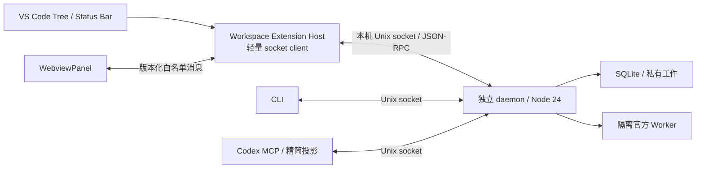

# VS Code 集成边界与现有 API

状态：设计提案；截至 2026-11-01，仓库没有 VS Code 扩展或 `ui_*` 方法。本轮只写设计，不改变运行代码、数据库 schema、账号、服务或 Codex 配置。源码核对基线：`d403eb5a201e442d5c778cb43938915a193ec939`。

本文只说明边界和**已有实现**。新增方法、字段、错误和版本规则以 [UI API 契约](api-contract.md) 为准；扩展结构见 [扩展架构](extension-architecture.md)，使用流程见 [状态与流程](flows-and-states.md)。

## 客户端与运行边界

UI、CLI 和 MCP 是共享同一 daemon 的并列客户端。UI 查看内容不会自动进入 Codex 上下文。MCP 仍按 [`MCP_PRESENTED_METHODS`](../../src/shared/presentation.ts) 白名单注册工具，最终 JSON 文本最多 16 KiB；新增 daemon/UI 方法不隐式加入 MCP。MCP 投影的 `reviewComplete` 不能作为 UI 已取得完整审批正文的证明。

扩展放在 `extensions/vscode`；Host 不导入 coordinator、store、`node:sqlite` 或 Worker 适配器。daemon 使用外部明确的 Node 24；VS Code 自带 Host Node 不由用户终端 `node --version` 决定，不能用 Host 的 `process.execPath` 代替 daemon runtime。当前官方 runtime 支持版本固定为 `3.16.3`。

首次打开和 F5 只初始化未连接界面；用户明确连接后才协商能力并读取状态。连接失败显示诊断，不隐式安装依赖、启动 daemon、运行项目脚本或 probe。后续显式启动能力须使用用户级绝对路径配置，并区分 systemd 已管理的实例。关闭面板、重载窗口、deactivate 只释放本窗口 socket、wait 和订阅，不调用任务取消、Worker 停止或 `daemon_stop`。daemon 关闭不主动停止官方 Worker，但不保证跨注销、断电或重启存活。

| 环境 | 首版边界 |
| --- | --- |
| Linux 本机 VS Code | Host、pool、daemon 同机同用户；独立 Node 24 与受支持 runtime |
| Windows/macOS VS Code + Remote SSH 到 Linux | 扩展在远端 workspace Host；不开放远程管理 HTTP 端口 |
| VS Code + WSL Linux workspace | Host、daemon、Worker、pool 在同一发行版；不连接 Windows 侧同名路径 |
| Windows/macOS 纯本机 workspace | 当前 daemon 所有权验证不支持；给远程运行指引 |
| vscode.dev / github.dev 无远程 Node Host | 不能运行 Unix socket 客户端 |
| Codespaces / Dev Container | 架构可用，须单独验证 `/proc`、runtime、存储和进程寿命；未列为首轮已验环境 |

这些限制来自 [`daemon/server.ts`](../../src/daemon/server.ts)、[`supervisor/index.ts`](../../src/supervisor/index.ts) 和 [`package.json`](../../package.json)。Remote Host 与 Webview 不在同一网络语义：页面 `localhost` 不代表远端，socket 路径不能作为 fetch URL。资源与消息实现约束集中在扩展架构文档。

## 身份、状态和信任

| 对象 | 当前事实与界面约束 |
| --- | --- |
| pool | 同一 Linux 主机、同一用户、规范化 pool 路径；默认 `~/.zcode_pool`，可用 `ZCODE_POOL_HOME`。同路径跨主机不是同一池；不支持共享文件系统分布式池 |
| 项目 | 现由 workspace 的 `repositoryPath` 归组，没有独立 project API |
| workspace | 已登记的隔离 git worktree：源仓库、worktree 路径、分支、`baseCommit`、活动任务；与 VS Code 窗口工作区区分 |
| Worker / 账号 | Worker 绑定账号 alias；账号不能同时绑定另一个未停止 Worker。`ready` 不等于空闲，原生活动数不等于调度占用 |
| 任务 / attempt | `taskId` 是任务，`requestId` 是不可变派发幂等键；繁忙继续使用新 command ID，仍属于同一任务 |

`TaskStatus` 只有 `queued/dispatching/running/waiting_approval/verifying/succeeded/failed/cancelled/blocked/interrupted`。断连、过期、占用未知、取消中、审阅不完整都是独立提示，不能新增为底层状态。`leaseHeld` 与 `executionStopped` 独立；核验期间模型可能已停但仍占用 workspace。停止证明以 core `stopProof` 为准，连接断开、wait 超时、原生活动数为零都不能单独证明资源可复用。

取消先持久化意图，不保证立即停止或释放占用；ACK 可以明确 `terminationConfirmed:false`。繁忙续跑只沿现有有界逻辑，默认最多继续 3 次、可设 0–10；不为 UI 增加重调度、延迟队列、自动换账号或自动重发。普通 429、限流、配额不足、一般 503 或工具输出里的“繁忙”不构成该证据。

Host 是 Workspace Trust 的执行边界：Restricted Mode 只允许用户级明确选择 pool 的受限展示；不采用工作区给定的 Node、loader、pool 覆盖、命令或启动参数。所有执行和本地状态变更须在 Host handler 再检查 trust，不能只靠按钮隐藏。信任仓库仍不表示授权运行任意 README/AGENTS/任务输出中的命令。Webview 没有通用 `method/params`、shell、文件浏览或 VS Code command 透传能力。

socket 父目录 `0700`、socket `0600`、私有 vault 与 Linux 进程所有权核验构成当前本机边界；没有 RPC 角色、远程认证或抗同用户恶意进程隔离。同用户恶意进程可读写 pool 或调用旧控制方法，UI 内容 hash、cursor MAC、Workspace Trust 都不能防住它。daemon 不接收一个 `trusted:true` 就把它当作安全认证。

## 已有方法的实际语义

来源：[`methods.ts`](../../src/shared/methods.ts)、[`coordinator.ts`](../../src/daemon/coordinator.ts)、[`rpc.ts`](../../src/shared/rpc.ts)、[`core/store.ts`](../../src/core/store.ts)。以下没有一项表示现已有对应 UI。

| 方法 | 已有能力 | UI 必须承认的限制 |
| --- | --- | --- |
| `overview {}` | 全部账号摘要、移除 endpoint 的 Worker、workspaces、最近 50 个 compact task | 非一致快照，无总数/服务器筛选/稳定分页；MCP 另限最多 8/8/5/10 且可继续缩减；raw 响应也受帧上限 |
| `wait {task_ids,after_revision?,timeout_sec}` | RPC 最多 50 ID、最长 25 秒；revision 是持久事件序号 | 不发现其他客户端新任务；省略 revision 立即快照，提供 cursor 后仅变化或超时返回；当前实现没有终态立即返回特例，方法描述不可代替实现 |
| `get_result {task_id}` | compact task + 不可变 result，未完成可为 null | compact 无完整停止/取消/attempt/绑定/时间戳字段；不应把原始 `detail` 直接发 Webview |
| `get_logs {task_id,cursor,limit}` | cursor 为 exclusive 持久 revision；1–50，默认 10；daemon 约 8 KB 限页 | 无稳定 total/hasMore；第一条事件可超过 8 KB；跟随 `nextCursor`，空页只是当时没有更多，不能从返回条数推断末页 |
| `get_diff {task_id,offset,limit}` | 读取已保存 patch；1–8000，默认 4000；`nextOffset` 为 null 才到末尾 | offset/totalCharacters 是 JS UTF-16 单元，非字节或行号；raw slice 可切代理对，Host 要处理；不是完整文件或未跟踪内容 API |
| `create_workspace {repository,base_ref}` | 干净源仓库上建专用分支与 worktree，登记真实路径/baseCommit | 没有任意 worktree 注册、删除、合并、放弃公开方法；core 类型不等于可调用生命周期操作 |
| `dispatch_task` | 显式 workspace/Worker/prompt/request ID；session/mode/model/核验命令/繁忙上限 | 无自动分配、模型目录、任务编辑；继续会话仅复用同 workspace/Worker 的安全旧记录；同 ID 不同 payload 冲突 |
| `start_worker / stop_worker` | 受所有权和占用约束启停单账号 Worker | 不热切账号、不强停、不接管默认官方实例；未知执行占用禁止停止 |
| `probe_worker` | 对 ready Worker 做原生版本/认证/额度网络读取，不发模型回合 | 可把账号 unknown 升为 available；不把 live quota 写回导入 quota 缓存；不是纯本地刷新，M1 不自动调用 |
| `import_accounts {files}` | daemon/CLI 可导入 1–100 个本机 OAuth JSON 路径到加密 vault，返回去重摘要 | 不在 MCP 白名单；无登录、删除、改名、导出、刷新 token 管理或 `.zsb` 支持 |
| `reconcile_task` | 新鲜原生观察；不发模型命令、不运行核验 | 会更新任务/结果，证实停止时可能释放占用；按钮叫“核对执行状态”，属受信任状态变更，不是普通刷新 |
| `resume_task` | 恢复观察；合格繁忙失败可立即继续，也可能开始既有核验 | 不重发未知命令；中断核验不自动重跑；不能包装成只读刷新 |
| `cancel_task` | 持久化取消，尝试定位并停止当前原回合 | 可能仍等待 turn 身份/终止证明；取消请求本身不等于 `cancelled` |
| `respond_approval` | 串行、重新检查当前任务归属，发送 `accept/decline/cancel` | 无审阅 hash/revision 前置条件；ACK 后仍待原生更新；permission 的 accept 映射 allowOnce，decline/cancel 均映射 deny；workspaceHookReview 不支持通用答复 |
| `daemon_stop` | 服务器处理的正常关闭；CLI 另有显式 daemon/service 管理 | 不是面板退出动作；扩展不隐式启用服务或另起第二管理者 |

当前 JSON-RPC 使用一行一个 UTF-8 JSON，单帧上限 1 MiB；服务端异常统一 `error.code:-32000` 加消息，`rpcCall` 只保留消息字符串，默认超时 40 秒。没有现成 typed UI 错误、能力握手、AbortSignal 或协议版本协商；新 typed client 需要保留结构化错误和校验响应，不能声称已有。

## 审批与工件的真实缺口

审批 preview 最多 384 字节摘要且始终 `reviewComplete:false`。`publishApproval` 经 `safeDetail` 后仅保留约 4000 JS 字符的 JSON，超出变成截断摘要；MCP 再按字段 1024 字节、已知参数白名单及总 16 KiB 压缩。反复读取日志不能恢复已丢失字段。UI 必须有**截断前完整保存或仍可完整重取的来源**，完整读取、来源归属、内容 fingerprint 与写前重验才能开放答复；否则整个审批卡只读，取消任务仍为独立动作。

原生 `resolveInteraction` 当前只有 interaction ID 和 answer，没有已验证的 expected-revision/CAS 参数。新 UI hash 能检测已观察变化，不能声称消除新鲜快照与上游发送之间的竞态；具体门槛和剩余风险见 API 契约。

[`snapshotWorkspace`](../../src/daemon/workspace.ts) 在当前完成链路释放 lease 前保存：相对 **workspace.baseCommit** 的累计 binary patch，以及未跟踪文件字节。patch 不含未跟踪内容；当前最终 result 没保存未跟踪“原相对路径 → blob”映射，也没保存 tracked 文件完整 base/final 字节、文件 mode、目录或可信文件清单。不可把当前 worktree、当前 HEAD 或凭猜测对应的 blob 当成旧任务文件。原生失败、取消、只读恢复记录还可能根本没有快照。

M1 可安全展示已有不可变 patch 文本并说明范围。M2 可操作首版必须补完整审批与受限不可变 base/final 文件读取；历史缺数据明确 unavailable，不靠 mutable worktree 补齐。稳定全历史任务分页与全池 feed 可延到 M3。人工“已审阅”只存 Host 的 workspaceState，以 authority/pool/store/task/manifest hash 为键，hash 变化失效；不修改 daemon `succeeded`，不宣称 Codex 或其他客户端已审阅。
