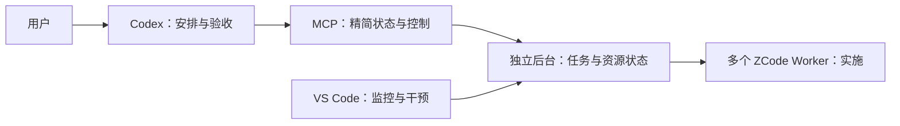

# 一体交付与 Codex 主控验证

日期：2026-11-01。扩展与后台版本 `0.1.0`，持久库 schema 4。

## 本轮交付

用户安装一个 VSIX；内部保留独立后台、MCP 接口和监控面板。Codex 通过 MCP 拆分与派发任务，ZCode Worker 实施，面板查看任务、额度并提供必要干预。CLI 是共用后台的管理入口，没有第二套调度逻辑。

- VSIX 包含编译后的后台及运行依赖；显式操作时校验并复制到稳定存储目录，无需另装本项目 npm 包。Node.js 24+ 和官方 ZCode 仍需执行侧提供。
- “连接 Codex / 生成 MCP 配置”生成说明文档，用户一次添加配置；不改真实 Codex 设置，不据此声称已经连接。
- MCP 与面板读取同一连接资料；后续工具调用跟随选定 pool，正在执行的调用保持原目标。缺失或损坏配置不静默切到默认池；显式保存可修复损坏普通文件。
- MCP 仅对已确定未发送请求的连接失败按需启动后台。不重发结果不明的操作，不自动启动 Worker。
- 后台统一执行并发任务上限：`null` 不额外限制，`0` 暂停新派发，`1–64` 设置上限；不取消已有任务，不新增自动队列。该限制是任务槽位上限，不等于常驻 Worker 进程数。
- 保留紧凑 MCP 输出与 16 KiB 上限；完整 Worker 上下文留在本地。无默认无限权限或自动批准。

## 自动验证

- 根项目 TypeScript 检查与 **186/186** 测试通过，包括并发准入、幂等性、旧库迁移、共享连接资料和 MCP 按需启动。
- 插件 Host/Webview TypeScript 检查与 **112/112** 单元测试通过，包括运行时安装、生成配置的路径转义、Node 版本检查和切换目标时取消旧启动。
- 插件 **7/7** 集成测试与 **10 组** Chrome 界面联动检查通过，覆盖三种主题、五种宽度、共享并发设置、审批和派发流程。
- VSIX 构建及交付文件白名单检查通过，生成包约 **597 KB**。
- VS Code **1.95.3** 隔离安装测试通过：只安装 VSIX，启动两个临时空池；关闭编辑器后后台存活；移除旧扩展安装目录后稳定 CLI/MCP 仍可用；同一 MCP 进程读取修改后的连接资料，按需连接对应后台。测试结束清理临时服务。

## 验证边界

本轮没有修改真实 Codex 配置、迁移或重启用户既有 pool，也没有派发真实模型任务。旧 daemon 不会随插件升级自动重启；要使用新能力，应处理当前任务后显式切换后台。原 Remote SSH 与真实模型验证见[此前记录](2026-11-01-vscode.md)，不作为本轮新增功能的实机验证。WSL、长时间高并发和用户新配置的 Codex 实际调度仍需后续验收。

后续生命周期调整：查询自动启动规则已被明确启动/收工替代，见[生命周期验证](2026-11-01-lifecycle.md)。本页保留当时的验证记录。
